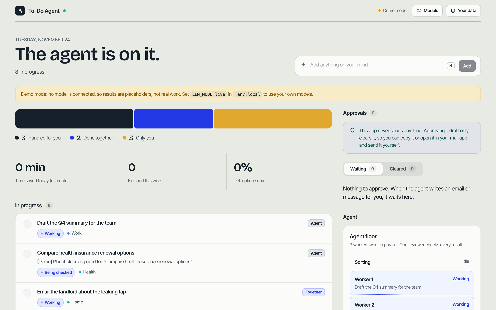
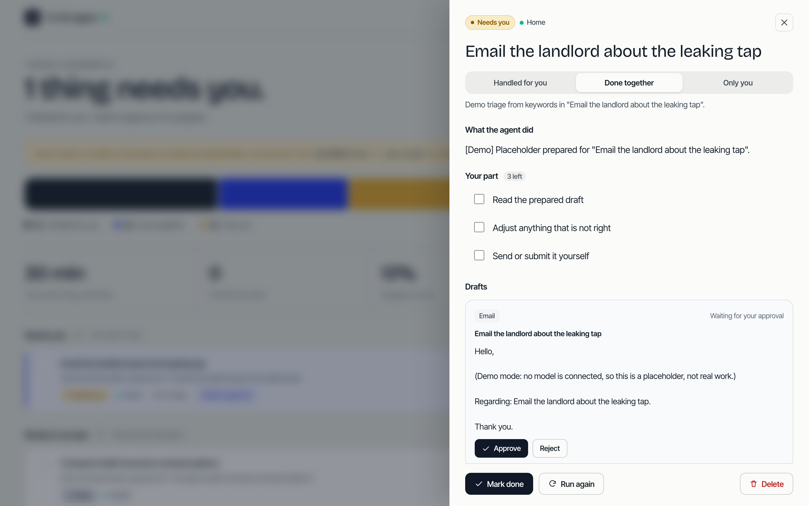
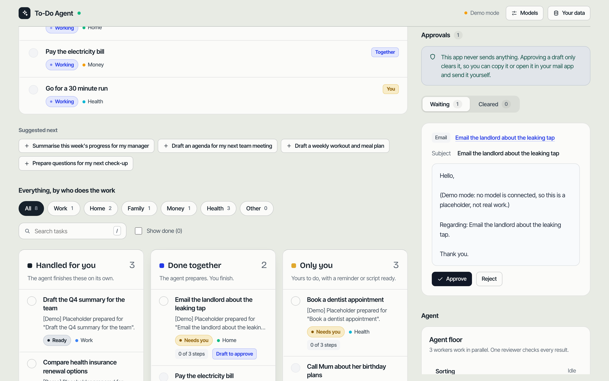
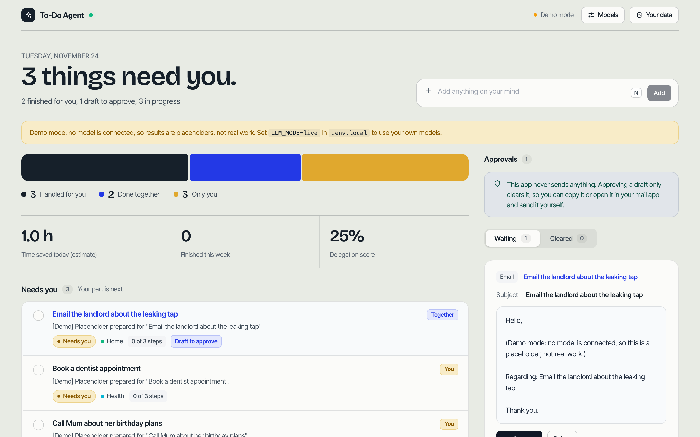
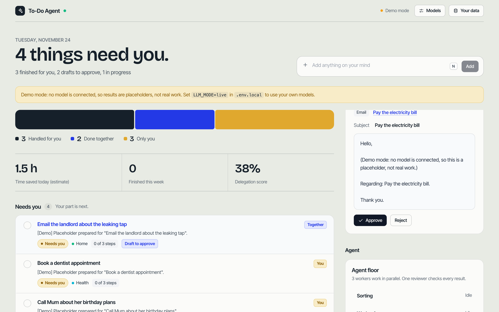
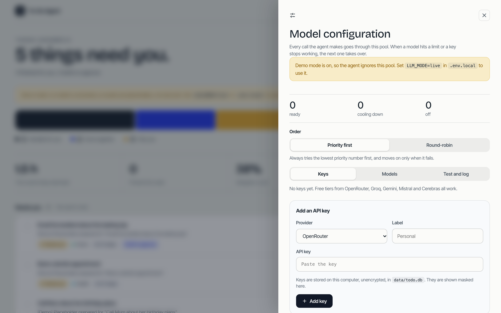
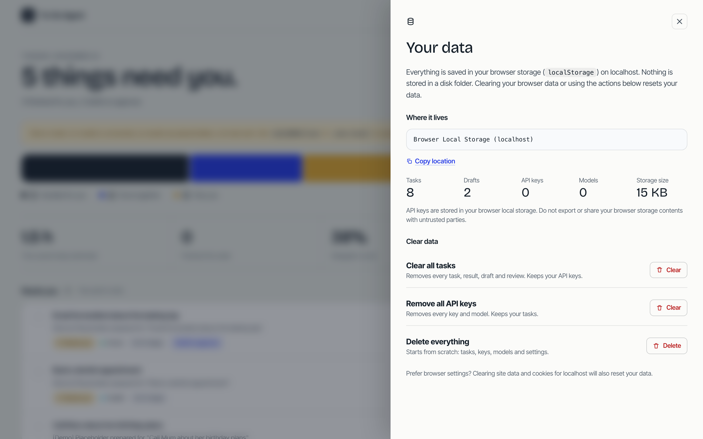
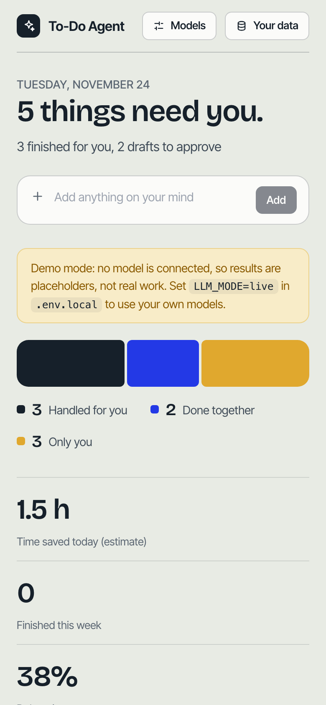

# To-Do Agent

*An autonomous, privacy-first personal task management system that triages, plans, drafts, and reviews everyday work with multi-agent orchestration and strict human-in-the-loop approval gates.*

[](https://nextjs.org/)
[](https://react.dev/)
[](https://www.typescriptlang.org/)
[](https://sqlite.org/)
[](https://turbo.build/)
[](https://vitest.dev/)
[](LICENSE)

---

## Overview

**To-Do Agent** is a calm, local-first autonomous productivity environment. Instead of maintaining a passive to-do list or letting an unconstrained AI access your personal accounts, To-Do Agent categorizes your life into three distinct piles, delegates work to parallel autonomous agents, enforces adversarial review on every output, and guarantees that outward-facing communication never leaves your machine without your explicit approval.

| Pile | Delegation Type | What the Agent Delivers |
|---|---|---|
| **Handled for you** | Autonomous execution | Finished research, structured plans, markdown deliverables, and comparison tables ready for your review. |
| **Done together** | Collaborative preparation | Pre-filled communication drafts, scheduled steps, and a personalized checklist of what remains for you to complete. |
| **Only you** | Personal commitment | Calendar reminders, preparation checklists, and phone scripts for tasks that strictly require your physical presence. |

---

## Visual Tour

### 1. Today Overview
The command center displays your daily metrics (estimated time saved, tasks completed this week, delegation score), task status lanes, and smart next-step suggestions.


### 2. Task Inspection & Adversarial Review
Clicking any task opens an in-depth slide-over drawer detailing the agent's work, rendered markdown deliverables, action steps, generated drafts, and the adversarial reviewer's verdict.


### 3. Three-Pile Kanban Board
View all tasks grouped into **Handled for you**, **Done together**, and **Only you**, complete with real-time text search and category filters (Health, Money, Family, Home, Work, Other).


### 4. Safety Outbox & Approvals
Outbound communications (emails, letters, submissions) sit in an isolated approvals queue. Approving a draft clears it for you to copy or open directly in your mail client.


### 5. Multi-Lane Agent Floor
Monitor real-time agent execution across sorting, concurrent worker lanes, and the dedicated reviewer lane, including reviewer pass/revise/flag statistics.


### 6. Resilient Model Pool & Routing
Configure API keys across providers (OpenRouter, Google Gemini, Groq, Mistral, Cerebras, or custom OpenAI-compatible endpoints) with priority routing, failover, and rate-limit cooldowns.


### 7. Zero-Cloud Privacy & Local Storage
All tasks, settings, and API keys reside exclusively in browser `localStorage` and temporary server memory. Export, import, or wipe your entire workspace with a single click.


### 8. Responsive Mobile Experience
Access your dashboard from your phone on the same Wi-Fi network with secure one-time token authorization (`npm run dev:lan`).
<p align="center">
  
</p>

---

## Key Features

### 🤖 Multi-Agent Orchestration
* **Triage Agent**: Rapidly analyzes raw task titles, assigning categories, priority levels, pile designations, and clear one-line rationales.
* **Worker Lanes (1–8 concurrent)**: Independent worker agents process tasks in parallel, synthesizing research, authoring deliverables, generating checklists, and composing communication drafts.
* **Single Reviewer Gate**: Every generated output must pass through a strict reviewer agent. The reviewer inspects for invented facts, unwarranted claims, missing requirements, and unapproved outbound communication. If the review fails, the task is sent back for revision or flagged for your attention.

### 🛡️ Ironclad Human-in-the-Loop Safety
* **No Outward Code Paths**: The codebase contains **zero** network integrations to send emails, execute financial transactions, or trigger third-party API mutations.
* **Drafts Approval Queue**: Any outbound message generated by a worker is placed in an approvals queue. Approving an item only clears it for manual copying or launching in your native mail application via `mailto:`.

### ⚡ Resilient LLM Pool Router
* **Dynamic Failover**: If a model returns a `429` (rate limit), it cools down automatically (honoring `Retry-After` headers or until midnight for daily quotas).
* **Provider Agnostic**: Seamlessly integrate OpenRouter, Google Gemini, Groq, Mistral, Cerebras, or local Ollama/vLLM endpoints.
* **Instant Offline Demo**: Run in zero-configuration mock mode (`LLM_MODE=mock`) with simulated triage, worker, and reviewer responses.

### 🔒 Zero-Disk Privacy Model
* **Ephemeral In-Memory Database**: Better-SQLite3 operates purely in `:memory:` by default.
* **Client-Side Rehydration**: Your browser's `localStorage` automatically syncs state and rehydrates the in-memory database on server restart. No SQLite files or user data are written to disk.
* **LAN Access Token Security**: Local network mode binds securely with `ACCESS_TOKEN` cookie verification and CSRF origin validation.

---

## Tech Stack

| Domain | Technology | Description |
|---|---|---|
| **Framework** | [Next.js 16.4.6](https://nextjs.org/) | App Router with Turbopack and Proxy Middleware |
| **Frontend** | [React 19.3.1](https://react.dev/) | React Server Components and concurrent client hooks |
| **Language** | [TypeScript 7.0](https://www.typescriptlang.org/) | Strict static typing across agents, routers, and UI |
| **Database** | [Better-SQLite3 13.2.0](https://github.com/WiseLibs/better-sqlite3) | Native in-memory relational store with `localStorage` sync |
| **Markdown** | [React-Markdown 10.1.0](https://github.com/remarkjs/react-markdown) | GFM-compliant markdown rendering for agent deliverables |
| **Validation** | [Zod 4.6.7](https://zod.dev/) | Strict runtime schema parsing for LLM JSON outputs |
| **Typography** | [Fontsource Variable](https://fontsource.org/) | High-legibility Inter Tight and Bricolage Grotesque fonts |
| **Testing** | [Vitest 5.1.1](https://vitest.dev/) / [Playwright](https://playwright.dev/) | Unit, integration, security guard, and E2E browser tests |

---

## Project Structure

```text
to-do-agent/
├── docs/
│   └── screenshots/              # High-resolution screenshots of all views
├── public/
│   └── humans.txt                # Creator and team credit
├── scripts/
│   └── lan.mjs                   # LAN runner for local Wi-Fi pairing
├── src/
│   ├── app/
│   │   ├── api/                  # RESTful API endpoints
│   │   │   ├── data/             # State export, import, and reset
│   │   │   ├── health/           # Router health and model availability
│   │   │   ├── llm/              # Model pool, provider keys, sync, and testing
│   │   │   ├── outbox/           # Draft approval and rejection
│   │   │   ├── start/            # Orchestrator worker execution trigger
│   │   │   ├── state/            # Full application state snapshot
│   │   │   ├── steps/            # Interactive checklist completion
│   │   │   └── tasks/            # Task creation, deletion, and queue actions
│   │   ├── globals.css           # Design tokens, spring physics, and typography
│   │   ├── layout.tsx            # Root layout with metadata and font imports
│   │   └── page.tsx              # Main entry point mounting Dashboard
│   ├── components/
│   │   ├── views/
│   │   │   ├── AgentView.tsx     # Live agent floor lanes and reviewer stats
│   │   │   ├── ApprovalsView.tsx # Outbox draft queue and approval controls
│   │   │   ├── BoardView.tsx     # 3-pile kanban board with category filters
│   │   │   └── TodayView.tsx     # Daily overview, metrics, and suggestions
│   │   ├── Dashboard.tsx         # App orchestrator shell, polling, and keyboard shortcuts
│   │   ├── DataDrawer.tsx        # Storage inspector and manual backup/restore
│   │   ├── Drawer.tsx            # TaskDetail & TaskDrawer slide-over inspector
│   │   ├── Footer.tsx            # Creator credit and dynamic copyright
│   │   ├── ModelsDrawer.tsx      # Model pool management, API keys, and test console
│   │   ├── QuickAdd.tsx          # Multi-line floating task input bar
│   │   ├── TaskRow.tsx           # Interactive task item card
│   │   ├── Topbar.tsx            # Header status bar with navigation triggers
│   │   └── ui.tsx                # Reusable icons, tags, and status pills
│   ├── lib/
│   │   ├── agents/               # Prompts and validated LLM JSON calls
│   │   ├── llm/                  # Routed LLM pool client and deterministic mock LLM
│   │   ├── router/               # Failover engine, cooldown manager, model discovery
│   │   ├── db.ts                 # SQLite connection and migration setup
│   │   ├── guard.ts              # CSRF origin validation and access token rules
│   │   ├── orchestrator.ts       # Triage, worker lane dispatch, and review loops
│   │   ├── store.ts              # Database operations and relational queries
│   │   └── types.ts              # Core TypeScript interfaces
│   ├── middleware.ts             # Next.js proxy middleware enforcing token security
│   └── proxy.ts                  # Next.js 16 proxy convention export
└── tests/                        # Vitest test suite (guard, data, gate, queue, router)
```

---

## Prerequisites

* **Node.js**: `v20.0.0` or higher (required for native ES modules and Next.js 16).
* **npm**: `v10.0.0` or higher.
* **Operating System**: macOS, Linux, or Windows (WSL recommended).

---

## Getting Started

### 1. Clone & Install Dependencies

```bash
git clone https://github.com/ashrafulasif/to-do-agent.git
cd to-do-agent
npm install
```

### 2. Configure Environment Variables

Copy the example environment configuration:

```bash
cp .env.example .env.local
```

### 3. Run in Offline Demo Mode (Mock)

To test the application immediately without providing API keys:

1. In `.env.local`, set:
   ```env
   LLM_MODE=mock
   ```
2. Start the development server:
   ```bash
   npm run dev
   ```
3. Open [http://localhost:3000](http://localhost:3000) in your browser.
4. Click **Try sample tasks** and then **Get it done** to watch the simulated triage, parallel workers, and reviewer execute.

### 4. Run in Live Mode (Real AI Models)

1. In `.env.local`, set:
   ```env
   LLM_MODE=live
   ```
2. Start the application:
   ```bash
   npm run dev
   ```
3. Open [http://localhost:3000](http://localhost:3000), click **Models** in the top navigation bar, and add an API key for any supported provider:
   * **Google Gemini**
   * **OpenRouter**
   * **Groq**
   * **Mistral**
   * **Cerebras**
   * **Custom OpenAI-Compatible** (Ollama, LocalAI, vLLM, Together, DeepSeek)
4. Click **Sync models** to populate the model pool, configure priority order, and send a test prompt.

---

## Environment Variables

| Variable | Required | Description | Default / Example |
|---|---|---|---|
| `LLM_MODE` | **Yes** | Operating mode: `live` uses configured model pool; `mock` runs offline deterministic demo. | `live` |
| `WORKER_CONCURRENCY` | No | Number of parallel worker lanes running simultaneously (integer between 1 and 8). | `3` |
| `TODO_DB` | No | SQLite database path. Defaults to in-memory with browser `localStorage` sync. Set a path (e.g. `./data.db`) for disk storage. | `:memory:` |
| `ACCESS_TOKEN` | Optional | Shared secret required when accessing over local Wi-Fi (`12+` characters). Enforced via cookie or `?token=` parameter. | `my-secret-wifi-token` |
| `PORT` | No | Port on which the Next.js server listens. | `3000` |

---

## Local Network Pairing (Phone on Same Wi-Fi)

Run To-Do Agent on your computer and access it seamlessly from your smartphone browser over your home Wi-Fi:

1. Set a secure secret in `.env.local`:
   ```env
   ACCESS_TOKEN="your-secure-random-token-here"
   ```
2. Launch the LAN server:
   ```bash
   npm run dev:lan
   # or after building: npm run start:lan
   ```
3. The terminal will output an authorized pairing link:
   ```text
   On your phone (same Wi-Fi), open once:
     http://192.168.1.15:3000/?token=your-secure-random-token-here
   ```
4. Open the link on your phone. A secure `HttpOnly` cookie will authenticate your device without re-entering the token.

---

## Available Commands

| Command | Description |
|---|---|
| `npm run dev` | Start the local Next.js development server on `http://localhost:3000` with Turbopack. |
| `npm run build` | Compile the optimized production build with Turbopack and TypeScript verification. |
| `npm start` | Run the compiled production Next.js server. |
| `npm run typecheck` | Execute TypeScript compiler check (`tsc --noEmit`) without emitting build files. |
| `npm test` | Run the complete Vitest test suite (75 tests covering guard, queue, router, gate, and data). |
| `npm run dev:lan` | Start the development server bound to `0.0.0.0` with mandatory token security for LAN devices. |
| `npm run start:lan` | Start the production server bound to `0.0.0.0` with mandatory token security for LAN devices. |

---

## API Reference

All mutative API endpoints validate CSRF origin headers against the server `Host` header.

| Endpoint | Method | Description |
|---|---|---|
| `/api/tasks` | `GET` | List all tasks, counts, and categories. |
| `/api/tasks` | `POST` | Add one or multiple new tasks (multi-line text parsing). |
| `/api/tasks/[id]` | `GET` | Retrieve task detail, deliverables, generated artifacts, drafts, and reviews. |
| `/api/tasks/[id]` | `DELETE` | Permanently remove a task and its associated records. |
| `/api/tasks/[id]` | `POST` | Execute a task action: `{ action: "requeue" \| "move" \| "rerun", pile?: string }`. |
| `/api/steps/[id]` | `PATCH` | Update completion state of an interactive sub-step: `{ done: boolean }`. |
| `/api/outbox/[id]` | `POST` | Decide on an outbound draft: `{ decision: "approved" \| "rejected" }`. |
| `/api/start` | `POST` | Trigger the orchestrator to begin processing queued inbox tasks. |
| `/api/state` | `GET` | Snapshot of full application state (tasks, approvals, cleared drafts, stats, config). |
| `/api/health` | `GET` | Router health status, active mode (`live` / `mock`), usable models, and cooldown timers. |
| `/api/data` | `GET` | Retrieve database metrics (task counts, key counts, storage mode). |
| `/api/data` | `DELETE` | Purge all tasks, drafts, steps, reviews, and logs. |
| `/api/data/sync` | `POST` | Bidirectional export/import endpoint for client `localStorage` synchronization. |
| `/api/llm/keys` | `POST` | Register a new provider API key in server memory. |
| `/api/llm/models/[id]` | `PATCH` | Toggle model enablement or adjust priority tier. |
| `/api/llm/actions` | `POST` | Reset model cooldowns or execute router health check completions. |

---

## Keyboard Shortcuts

| Shortcut | Action |
|---|---|
| `n` | Focus the Quick-Add task bar from anywhere. |
| `/` | Focus the Board search bar. |
| `j` / `k` | Navigate down / up through the tasks in the Today view. |
| `Enter` | Submit tasks from the Quick-Add bar. |
| `Shift` + `Enter` | Insert a new line in the Quick-Add bar (submits one task per line). |
| `Esc` | Dismiss any active slide-over drawer (Task Inspector, Models, Your Data). |

---

## Deployment

To deploy this application in production:

1. **Build the Production Bundle**:
   ```bash
   npm run build
   ```
2. **Start the Production Server**:
   ```bash
   npm start
   ```
3. **Environment Setup**: Ensure `LLM_MODE=live` is configured in production environment variables, along with any optional `ACCESS_TOKEN` for network access control. Note that `better-sqlite3` uses native bindings, so ensure the deployment target supports Node.js 20+ with native compilation tools.

---

## Contributing

1. Fork the repository and create a feature branch (`git checkout -b feature/improvement`).
2. Verify code quality, formatting, and unit tests:
   ```bash
   npm run typecheck && npm test
   ```
3. Commit your changes and open a pull request.

---

## Creator & Attribution

Designed & built by **[Ashraful Asif](https://ashrafulasif.vercel.app)**.

For full developer credits and team specification, refer to [public/humans.txt](public/humans.txt).

---

## License

This project is licensed under the **MIT License**.
